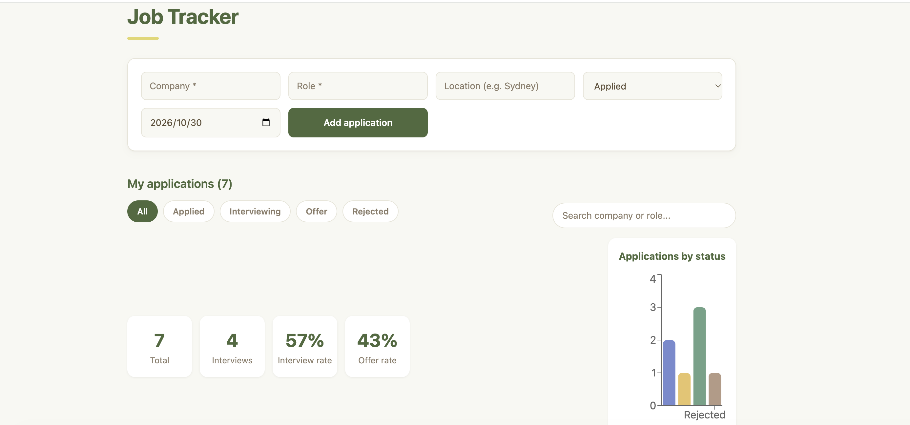

# Job Application Tracker

A minimalist job application tracker with a soft, fresh colour palette and an uncluttered dashboard. I built it to organise my own job search in Australia, so every feature comes from something I actually needed while applying.

**Live demo:** https://job-tracker-aiming.vercel.app



## Features

- **Add applications** with company, role, location, status and date applied
- **Clean table view** that lines up every application at a glance, and scrolls horizontally on small screens
- **Inline status updates**: change an application from Applied to Interviewing, Offer or Rejected directly in the table, with colour-coded status badges
- **Filter by status** with one click (All / Applied / Interviewing / Offer / Rejected)
- **Search** by company or role as you type
- **Stats dashboard** showing total applications, interviews, interview rate and offer rate
- **Status chart** that visualises where your applications stand
- **Delete with confirmation**, so nothing disappears by accident
- **Data persistence** with localStorage, so your records survive a page refresh

## Design

I wanted the app to feel calm rather than stressful, because job hunting already is. The interface uses a soft green and warm brown palette, plenty of white space and a single-column layout, so the information you care about stands out without visual noise. Colours are defined as CSS variables, which keeps the theme consistent across components and easy to adjust.

## Tech Stack

| Area | Tools |
|---|---|
| Framework | React, TypeScript |
| Build tool | Vite |
| Charts | Recharts |
| Styling | CSS with custom properties (variables) |
| Storage | Browser localStorage |
| Deployment | Vercel, with automatic deployments on every push to `main` |

## Getting Started

Requires Node.js 20.19 or later.

```bash
git clone https://github.com/IvyC2/job-tracker.git
cd job-tracker
npm install
npm run dev
```

Then open http://localhost:5173 in your browser.

To create a production build:

```bash
npm run build
npm run preview
```

## Challenges and What I Learned

**Keeping state minimal with derived data.** My first idea for filtering was to store the filtered list in its own state, but that would mean keeping two arrays in sync every time an application is added, edited or deleted. Instead, state holds only the full list and the current filter, and the visible list is calculated on each render. This removed a whole class of sync bugs and made filtering and search easy to combine.

**Debugging a deployment that wouldn't update.** After my first deployment, new pushes weren't showing up on the live site. I noticed my GitHub commits had no Vercel status check, which meant Vercel wasn't receiving them. Running `git remote -v` showed my local project was pushing to a different repository from the one Vercel was connected to. Reconnecting Vercel to the correct repository fixed it, and every push to `main` now deploys automatically.

## Roadmap

- [ ] Unit and component tests with Vitest and React Testing Library
- [ ] GitHub Actions to run tests on every push
- [ ] Sort by date or company
- [ ] Notes and job links for each application
- [ ] Backend and login so data syncs across devices

## Author

Built by [IvyC2](https://github.com/IvyC2).
